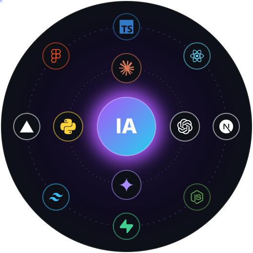

<p align="center">
  
</p>

<p align="center">
  <a href="https://wa.me/5551989135377?text=Oi%2C%20Alisson!%20Vi%20seu%20perfil%20no%20GitHub%20e%20quero%20conversar%20sobre%20um%20projeto."></a>
  <a href="#jogo"></a>
  
</p>

##  Sobre mim



Sou **engenheiro de IA e desenvolvedor de software**. Junto modelos de linguagem e interfaces bem feitas para criar produtos que resolvem problemas reais, da primeira ideia ao deploy.

- 🤖 **IA aplicada:** agentes, automações e integrações com Claude, GPT e Gemini
- 🧠 **Engenharia de prompt:** prompts estruturados, testados e documentados para produção
- 💻 **Software:** aplicações web com TypeScript, Next.js, React e Supabase
- 🎨 **Interface:** design visual e UX, do Figma ao deploy na Vercel
- 📍 Brasil 🇧🇷

> _"Um bom prompt é como um bom briefing: ele determina a qualidade de tudo o que vem depois."_

<details>
<summary><b><code>$ cat whoami.json</code></b> &nbsp;<sub>clique para abrir</sub></summary>

```json
{
  "nome": "Alisson Mendes",
  "cargo": ["Engenheiro de IA", "Desenvolvedor de Software"],
  "local": "Brasil 🇧🇷",
  "foco": ["Agentes de IA", "LLMs em produção", "Produtos web"],
  "missão": "Unir design visual e IA generativa em produtos de verdade",
  "filosofia": "Um bom prompt muda tudo."
}
```

</details>

<details>
<summary><b><code>$ man engenharia-de-prompt</code></b> &nbsp;<sub>como eu trabalho com IA</sub></summary>
<br>

1. **Entendo o problema** antes de escolher o modelo
2. **Estruturo o prompt** com contexto, exemplos e formato de saída
3. **Testo com casos reais** e meço o que melhorou
4. **Documento e versiono** para o prompt continuar funcionando em produção

</details>

<br clear="right">

##  Stack

<table>
  <tr>
    <td align="center"><b>IA</b></td>
    <td>
      
      
      
      
    </td>
  </tr>
  <tr>
    <td align="center"><b>Linguagens</b></td>
    <td></td>
  </tr>
  <tr>
    <td align="center"><b>Web</b></td>
    <td></td>
  </tr>
  <tr>
    <td align="center"><b>Ferramentas</b></td>
    <td></td>
  </tr>
</table>

##  Projetos no ar

| Projeto | O que é | Stack |
| :-- | :-- | :-- |
| **[PACHE.CO](https://pache-co.vercel.app)** | Catálogo de streetwear com painel administrativo | Next.js 16 · TypeScript · Supabase |
| **[Duda Margotti Beauty](https://duda-margotti-beauty.vercel.app)** | Site de maquiagem, cabelo e estética em Canoas/RS | TypeScript · Vercel |

<a name="jogo"></a>

##  Jogue contra minha IA

<p align="center">
  Você é o ❌ e a minha IA é o ⭕. Clique numa casa vazia, confirme a issue que abrir e, em uns 30 segundos, a IA responde e o tabuleiro muda aqui (é só recarregar a página).<br>
  <sub>O tabuleiro é um só para todo mundo. Spoiler: a IA joga com <b>minimax</b> e nunca perde. Será que você consegue empatar?</sub>
</p>

<!-- JOGO:INICIO -->
<p align="center">
<a href="https://github.com/devMendes23/devMendes23/issues/new?title=ttt%7Cjogar%7C1&body=%F0%9F%91%87%20%C3%89%20s%C3%B3%20clicar%20em%20%2A%2ACreate%2A%2A%20%28ou%20%2ASubmit%20new%20issue%2A%29.%0A%0AEm%20cerca%20de%2030%20segundos%20a%20IA%20responde%20aqui%20e%20o%20tabuleiro%20atualiza%20no%20perfil."></a><a href="https://github.com/devMendes23/devMendes23/issues/new?title=ttt%7Cjogar%7C2&body=%F0%9F%91%87%20%C3%89%20s%C3%B3%20clicar%20em%20%2A%2ACreate%2A%2A%20%28ou%20%2ASubmit%20new%20issue%2A%29.%0A%0AEm%20cerca%20de%2030%20segundos%20a%20IA%20responde%20aqui%20e%20o%20tabuleiro%20atualiza%20no%20perfil."></a><a href="https://github.com/devMendes23/devMendes23/issues/new?title=ttt%7Cjogar%7C3&body=%F0%9F%91%87%20%C3%89%20s%C3%B3%20clicar%20em%20%2A%2ACreate%2A%2A%20%28ou%20%2ASubmit%20new%20issue%2A%29.%0A%0AEm%20cerca%20de%2030%20segundos%20a%20IA%20responde%20aqui%20e%20o%20tabuleiro%20atualiza%20no%20perfil."></a><br>
<a href="https://github.com/devMendes23/devMendes23/issues/new?title=ttt%7Cjogar%7C4&body=%F0%9F%91%87%20%C3%89%20s%C3%B3%20clicar%20em%20%2A%2ACreate%2A%2A%20%28ou%20%2ASubmit%20new%20issue%2A%29.%0A%0AEm%20cerca%20de%2030%20segundos%20a%20IA%20responde%20aqui%20e%20o%20tabuleiro%20atualiza%20no%20perfil."></a><a href="https://github.com/devMendes23/devMendes23/issues/new?title=ttt%7Cjogar%7C5&body=%F0%9F%91%87%20%C3%89%20s%C3%B3%20clicar%20em%20%2A%2ACreate%2A%2A%20%28ou%20%2ASubmit%20new%20issue%2A%29.%0A%0AEm%20cerca%20de%2030%20segundos%20a%20IA%20responde%20aqui%20e%20o%20tabuleiro%20atualiza%20no%20perfil."></a><a href="https://github.com/devMendes23/devMendes23/issues/new?title=ttt%7Cjogar%7C6&body=%F0%9F%91%87%20%C3%89%20s%C3%B3%20clicar%20em%20%2A%2ACreate%2A%2A%20%28ou%20%2ASubmit%20new%20issue%2A%29.%0A%0AEm%20cerca%20de%2030%20segundos%20a%20IA%20responde%20aqui%20e%20o%20tabuleiro%20atualiza%20no%20perfil."></a><br>
<a href="https://github.com/devMendes23/devMendes23/issues/new?title=ttt%7Cjogar%7C7&body=%F0%9F%91%87%20%C3%89%20s%C3%B3%20clicar%20em%20%2A%2ACreate%2A%2A%20%28ou%20%2ASubmit%20new%20issue%2A%29.%0A%0AEm%20cerca%20de%2030%20segundos%20a%20IA%20responde%20aqui%20e%20o%20tabuleiro%20atualiza%20no%20perfil."></a><a href="https://github.com/devMendes23/devMendes23/issues/new?title=ttt%7Cjogar%7C8&body=%F0%9F%91%87%20%C3%89%20s%C3%B3%20clicar%20em%20%2A%2ACreate%2A%2A%20%28ou%20%2ASubmit%20new%20issue%2A%29.%0A%0AEm%20cerca%20de%2030%20segundos%20a%20IA%20responde%20aqui%20e%20o%20tabuleiro%20atualiza%20no%20perfil."></a><a href="https://github.com/devMendes23/devMendes23/issues/new?title=ttt%7Cjogar%7C9&body=%F0%9F%91%87%20%C3%89%20s%C3%B3%20clicar%20em%20%2A%2ACreate%2A%2A%20%28ou%20%2ASubmit%20new%20issue%2A%29.%0A%0AEm%20cerca%20de%2030%20segundos%20a%20IA%20responde%20aqui%20e%20o%20tabuleiro%20atualiza%20no%20perfil."></a>
</p>

<p align="center"><sub>Tabuleiro novinho: faça a primeira jogada!</sub></p>
<p align="center"><b>Placar da comunidade</b><br>🧑 Humanos <b>0</b> &nbsp;·&nbsp; 🤖 IA <b>0</b> &nbsp;·&nbsp; 🤝 Empates <b>0</b></p>
<!-- JOGO:FIM -->

##  No GitHub

<p align="center">
  
  
</p>


